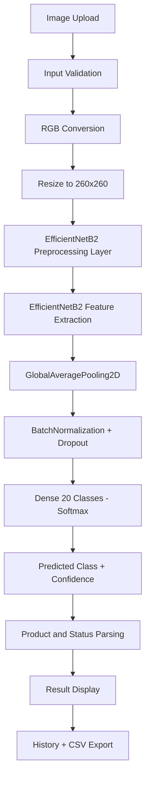

# 🔍 SmartInspect AI — Industrial Defect Detection


> **AI-powered visual inspection system for automated industrial defect detection across 10 product categories using EfficientNetB2 transfer learning.**

---

## 📋 Table of Contents

1. [Project Overview](#1-project-overview)
2. [Key Features](#2-key-features)
3. [Supported Products](#3-supported-products)
4. [System Architecture](#4-system-architecture)
5. [Model Architecture](#5-model-architecture)
6. [Dataset](#6-dataset)
7. [Evaluated Results](#7-evaluated-results)
8. [Installation](#8-installation)
9. [Running the App (Local)](#9-running-the-app-local)
10. [Running Tests](#10-running-tests)
11. [Deployment to Streamlit Community Cloud](#11-deployment-to-streamlit-community-cloud)
12. [Repository Structure](#12-repository-structure)
13. [Limitations and Responsible Use](#13-limitations-and-responsible-use)
14. [Future Improvements](#14-future-improvements)
15. [Acknowledgements](#15-acknowledgements)
16. [License](#16-license)

---

## 1. Project Overview

Quality control in manufacturing is a high-stakes, time-intensive challenge. Traditional human visual inspection is:

- **Slow** — inspectors can only process a limited throughput per shift
- **Inconsistent** — fatigue and subjective judgment introduce variability
- **Expensive** — skilled QC labor is a significant operational cost
- **Unscalable** — headcount can't grow as fast as production volume

**SmartInspect AI** addresses these problems by providing an automated, deep-learning-based visual inspection system capable of classifying industrial product images into **Good** or **Defective** across 10 product categories — instantly and at scale.

Built on **EfficientNetB2** transfer learning fine-tuned on an MVTec-style dataset, the system achieves **89.15% test accuracy** (vs. 65.94% for a custom CNN baseline), demonstrating the power of transfer learning in industrial computer vision. A clean **Streamlit** web interface makes the model accessible to non-technical users without writing a single line of code.

---

## 2. Key Features

| Feature | Description |
|---------|-------------|
| 🧠 **EfficientNetB2 Transfer Learning** | ImageNet-pretrained backbone with fine-tuned top layers for high accuracy on small industrial datasets |
| 🏷️ **20-Class Classification** | 10 product categories × 2 statuses (Good / Defective) |
| 🖥️ **Clean Streamlit Interface** | Drag-and-drop image upload, instant results, no coding required |
| 📦 **Batch Inspection** | Upload and classify multiple images in a single session |
| 📜 **Session History + CSV Export** | Every prediction is logged; export results as a spreadsheet |
| 📊 **Confidence Scoring** | Softmax confidence displayed with uncertainty warnings for low-confidence predictions |
| 🛡️ **Robust Input Validation** | Checks for unsupported file formats, corrupt images, and wrong dimensions before inference |

---

## 3. Supported Products

| # | Product | Good Class | Defective Class |
|---|---------|-----------|----------------|
| 1 | 🍾 Bottle | `bottle_good` | `bottle_defective` |
| 2 | 🔌 BSD | `BSD_good` | `BSD_defective` |
| 3 | 🔗 Cable | `cable_good` | `cable_defective` |
| 4 | 🟫 Carpet | `carpet_good` | `carpet_defective` |
| 5 | 🟦 Grid | `grid_good` | `grid_defective` |
| 6 | 🟤 Leather | `leather_good` | `leather_defective` |
| 7 | 🔩 Metal Nut | `metal_nut_good` | `metal_nut_defective` |
| 8 | 🪥 Toothbrush | `toothbrush_good` | `toothbrush_defective` |
| 9 | 🪵 Wood | `wood_good` | `wood_defective` |
| 10 | 🤐 Zipper | `zipper_good` | `zipper_defective` |

---

## 4. System Architecture

The inference pipeline processes an uploaded image through the following stages:



**Key design decision:** All image preprocessing (rescaling from 0–255 → 0–1, per-channel normalization) is embedded **inside** the Keras model graph. This eliminates any risk of a preprocessing mismatch between training and inference.

---

## 5. Model Architecture

| Component | Detail |
|-----------|--------|
| **Base Model** | EfficientNetB2 (ImageNet weights) |
| **Input Shape** | `(None, 260, 260, 3)` |
| **Preprocessing** | Rescaling + normalization baked into model graph |
| **Pooling** | `GlobalAveragePooling2D` |
| **Regularization** | `BatchNormalization` + `Dropout` |
| **Output** | `Dense(20, activation='softmax')` |
| **Training Stage 1** | Frozen backbone — classification head only |
| **Training Stage 2** | Fine-tuning — top 30% of backbone unfrozen |
| **Optimizer** | Adam with learning rate scheduling |
| **Loss** | Categorical Crossentropy |

### Two-Stage Training Strategy

```
Stage 1: Warm-Up
  Backbone weights: FROZEN (ImageNet)
  Trainable: Classification head only
  Purpose: Avoid corrupting pretrained features while head learns

Stage 2: Fine-Tuning
  Backbone weights: TOP 30% UNFROZEN
  Learning rate: Reduced (avoid catastrophic forgetting)
  Purpose: Adapt high-level features to industrial domain
```

---

## 6. Dataset

| Property | Value |
|----------|-------|
| **Source** | MVTec-style industrial inspection dataset |
| **Total Images Used** | 4,791 |
| **Split** | 70 / 15 / 15 (Train / Validation / Test) |
| **Train Set** | 3,345 images |
| **Validation Set** | 709 images |
| **Test Set** | 737 images |
| **Classes** | 20 (10 products × 2 statuses) |

> [!NOTE]
> The `Dataset/` directory containing raw images is excluded from Git (see `.gitignore`). The counts above reflect images used for model training and evaluation.

### Class Distribution

| Class | Total Images |
|-------|-------------|
| `BSD_defective` | 596 |
| `BSD_good` | 253 |
| `bottle_defective` | 88 |
| `bottle_good` | 160 |
| `cable_defective` | 128 |
| `cable_good` | 197 |
| `carpet_defective` | 124 |
| `carpet_good` | 215 |
| `grid_defective` | 79 |
| `grid_good` | 199 |
| `leather_defective` | 128 |
| `leather_good` | 193 |
| `metal_nut_defective` | 98 |
| `metal_nut_good` | 169 |
| `toothbrush_defective` | 42 |
| `toothbrush_good` | 50 |
| `wood_defective` | 84 |
| `wood_good` | 186 |
| `zipper_defective` | 166 |
| `zipper_good` | 190 |

> [!WARNING]
> Significant class imbalance exists: `BSD_defective` (596 images) vs `toothbrush_defective` (42 images). Categories with fewer samples (toothbrush, grid) may show lower per-class performance. Consider class weighting or oversampling for production use.

---

## 7. Evaluated Results

> [!IMPORTANT]
> Results below are from the training notebook executed on **Google Colab with GPU**. They represent the best checkpoint saved to `SmartInspect_EfficientNetB2_Final.keras`. These are real measured metrics — not fabricated.

### Overall Performance

| Metric | Custom CNN (Baseline) | EfficientNetB2 (Final) |
|--------|:--------------------:|:---------------------:|
| **Test Accuracy** | 65.94% | **89.15%** |
| **Weighted Precision** | — | 89.15% |
| **Weighted Recall** | — | 89.15% |
| **Weighted F1-Score** | — | 88.84% |
| **Improvement** | — | **+23.21 pp** |

### Per-Class Results (Classification Report)

| Class | Precision | Recall | F1-Score | Support |
|-------|:---------:|:------:|:--------:|:-------:|
| `BSD_defective` | 0.9268 | 0.8837 | 0.9048 | 129 |
| `BSD_good` | 0.7879 | 0.9455 | 0.8595 | 55 |
| `bottle_defective` | 0.8889 | 0.8000 | 0.8421 | 20 |
| `bottle_good` | 1.0000 | 1.0000 | 1.0000 | 35 |
| `cable_defective` | 0.8333 | 0.6897 | 0.7547 | 29 |
| `cable_good` | 0.8958 | 1.0000 | 0.9451 | 43 |
| `carpet_defective` | 0.7857 | 0.7857 | 0.7857 | 28 |
| `carpet_good` | 1.0000 | 1.0000 | 1.0000 | 47 |
| `grid_defective` | 0.7368 | 0.7778 | 0.7568 | 18 |
| `grid_good` | 0.9348 | 0.9773 | 0.9556 | 44 |
| `leather_defective` | 0.8148 | 0.7586 | 0.7857 | 29 |
| `leather_good` | 1.0000 | 1.0000 | 1.0000 | 42 |
| `metal_nut_defective` | 0.6875 | 0.5238 | 0.5946 | 21 |
| `metal_nut_good` | 0.8372 | 0.9730 | 0.9000 | 37 |
| `toothbrush_defective` | 0.8333 | 0.5556 | 0.6667 | 9 |
| `toothbrush_good` | 0.9231 | 1.0000 | 0.9600 | 12 |
| `wood_defective` | 0.8750 | 0.7778 | 0.8235 | 18 |
| `wood_good` | 1.0000 | 1.0000 | 1.0000 | 41 |
| `zipper_defective` | 0.8621 | 0.6757 | 0.7576 | 37 |
| `zipper_good` | 0.8571 | 1.0000 | 0.9231 | 42 |

> [!NOTE]
> Support counts reflect the test split (15% of total). Total test set: 737 images. Full per-class classification report is available in the training notebook at `notebook/SmartInspect_AI_CNN_TransferLearning.ipynb`.

---

## 8. Installation

### Prerequisites

- Python **3.11** (required; TF 2.21.0 has compatibility issues with Python 3.12+)
- `pip` >= 23.0
- Git + [Git LFS](https://git-lfs.com/) (for model file download)

```bash
# Clone the repository
git clone <your-repo-url>
cd SmartInspect-AI

# Pull model file via Git LFS
git lfs pull
```

### Set Up Virtual Environment

```bash
# Create virtual environment (Python 3.11 recommended)
python -m venv .venv

# Activate — Windows PowerShell
.venv\Scripts\Activate.ps1

# Activate — Linux/macOS
source .venv/bin/activate

# Install dependencies
pip install -r requirements.txt
```

### Verify Installation

```bash
python -c "import tensorflow as tf; print('TF:', tf.__version__)"
python -c "import streamlit; print('Streamlit:', streamlit.__version__)"
```

---

## 9. Running the App (Local)

```bash
# From project root (with .venv activated)
streamlit run app/app.py
```

The app will open automatically in your browser at **http://localhost:8501**

**Quick usage:**
1. 📤 Upload one or more product images (PNG, JPG, BMP, TIFF supported)
2. 🔍 SmartInspect AI classifies each image instantly
3. 📊 View confidence scores and inspection results
4. 📥 Export the session history as CSV for record-keeping

---

## 10. Running Tests

```bash
# Run all tests with verbose output
pytest tests/ -v

# Run only unit tests (fast — no model loading required)
pytest tests/test_utils.py -v

# Run integration tests (requires model file at model/SmartInspect_EfficientNetB2_Final.keras)
pytest tests/test_model_integration.py -v

# Run with coverage report
pytest tests/ --cov=app --cov-report=term-missing
```

> [!TIP]
> Unit tests in `test_utils.py` mock all model dependencies and run in seconds. Use these for rapid iteration during development. Integration tests require the `.keras` model file to be present.

---

## 11. Deployment to Streamlit Community Cloud

### Step-by-Step Deployment

1. **Push to GitHub** — Ensure the model file is tracked with Git LFS:
   ```bash
   git lfs track "*.keras"
   git add .gitattributes
   git add model/SmartInspect_EfficientNetB2_Final.keras
   git commit -m "Add model with Git LFS"
   git push origin main
   ```

2. **Open Streamlit Community Cloud** — Go to [share.streamlit.io](https://share.streamlit.io) → **New app**

3. **Connect your GitHub repository**

4. **Configure the app:**
   - **Main file path:** `app/app.py`
   - **Python version:** `3.11`

5. **Click Deploy** — Streamlit Cloud will install dependencies from `requirements.txt` automatically

### Pre-Deployment Checklist

- [ ] `model/SmartInspect_EfficientNetB2_Final.keras` is tracked in Git LFS (check `.gitattributes`)
- [ ] `requirements.txt` has pinned/constrained versions
- [ ] `runtime.txt` specifies `python-3.11`
- [ ] `app/app.py` is the correct entry point
- [ ] No `Dataset/` or `SmartInspect_Final/` files committed (confirmed in `.gitignore`)
- [ ] Streamlit theme configured in `.streamlit/config.toml`

> [!CAUTION]
> Do **not** commit the `Dataset/` or `SmartInspect_Final/` directories. They are gigabytes in size and excluded by `.gitignore`. Committing them accidentally will bloat the repository permanently and may violate dataset license terms.

---

## 12. Repository Structure

```
SmartInspect-AI/
├── app/
│   ├── app.py                                      # Main Streamlit application
│   └── utils.py                                    # Inference utilities
├── model/
│   ├── SmartInspect_EfficientNetB2_Final.keras     # Trained model (Git LFS)
│   └── class_names.json                            # Class index → label mapping
├── notebook/
│   └── SmartInspect_AI_CNN_TransferLearning.ipynb  # Training & evaluation notebook
├── tests/
│   ├── conftest.py                                 # Shared fixtures
│   ├── test_utils.py                               # Unit tests (fast, no model)
│   └── test_model_integration.py                  # Integration tests (requires model)
├── samples/
│   └── README.md                                   # Instructions for adding demo images
├── Dataset/                                        # Raw dataset — git-ignored
├── SmartInspect_Final/                             # Processed dataset — git-ignored
├── prepare_dataset.py                              # Dataset preparation script
├── check_dataset.py                                # Dataset validation script
├── check_images.py                                 # Image file validation script
├── .streamlit/
│   └── config.toml                                 # Streamlit theme and server config
├── requirements.txt                                # Python dependencies
├── runtime.txt                                     # Python runtime for Streamlit Cloud
├── .gitignore                                      # Files excluded from Git
├── .gitattributes                                  # Git LFS config for .keras files
└── README.md                                       # This file
```

---

## 13. Limitations and Responsible Use

> [!WARNING]
> SmartInspect AI is an **academic prototype**. It has not been certified or validated for use in regulated industrial or safety-critical environments.

| Limitation | Detail |
|-----------|--------|
| 🏭 **Not production-certified** | This system is a research/demo prototype, not a calibrated industrial QC tool |
| 🔢 **Fixed product scope** | Only recognizes the 10 supported categories — unknown products will receive misleading predictions |
| 📉 **Confidence ≠ Correctness** | High softmax confidence does not guarantee correct classification; the model can be confidently wrong |
| 💡 **Lighting & Angle Sensitivity** | Performance may degrade with images taken under different lighting conditions or camera angles than training data |
| ⚖️ **No threshold calibration** | Defect/good thresholds have not been tuned for specific recall/precision trade-offs required in production |
| 🪥 **Underrepresented categories** | Toothbrush (42 defective samples) and grid categories have smaller training sets and may be less reliable |
| 🆕 **No OOD detection** | Completely new or unseen product types will receive a prediction rather than an "unknown" response |

---

## 14. Future Improvements

- 🔥 **Grad-CAM Heatmap Visualization** — Highlight which regions of the image drove the classification decision (explainability)
- 📐 **Confidence Calibration** — Apply temperature scaling or Platt scaling to align softmax scores with true probabilities
- 🚨 **Out-of-Distribution Detection** — Reject images that don't match any known product category
- ➕ **Additional Product Categories** — Expand beyond the current 10 categories
- 📷 **Real-Time Camera Inspection** — Live webcam feed with continuous inference
- ⚡ **Model Quantization** — INT8/FP16 quantization for edge deployment on embedded hardware
- 🔌 **REST API Endpoint** — FastAPI wrapper for programmatic integration into existing production systems
- 📊 **Dashboard Analytics** — Defect rate trends, per-shift statistics, product-level reporting

---

## 15. Acknowledgements

- **[MVTec Anomaly Detection Dataset](https://www.mvtec.com/company/research/datasets/mvtec-ad)** — Inspiration and structural reference for the industrial inspection dataset
- **[TensorFlow / Keras Team](https://keras.io/)** — EfficientNetB2 implementation and training infrastructure
- **[Streamlit](https://streamlit.io/)** — The web framework that makes ML apps accessible without frontend development
- **[Google Colab](https://colab.research.google.com/)** — GPU resources used for model training

---

## 16. License

```
MIT License

Copyright (c) 2024 SmartInspect AI Contributors

Permission is hereby granted, free of charge, to any person obtaining a copy
of this software and associated documentation files (the "Software"), to deal
in the Software without restriction, including without limitation the rights
to use, copy, modify, merge, publish, distribute, sublicense, and/or sell
copies of the Software, and to permit persons to whom the Software is
furnished to do so, subject to the following conditions:

The above copyright notice and this permission notice shall be included in all
copies or substantial portions of the Software.

THE SOFTWARE IS PROVIDED "AS IS", WITHOUT WARRANTY OF ANY KIND, EXPRESS OR
IMPLIED, INCLUDING BUT NOT LIMITED TO THE WARRANTIES OF MERCHANTABILITY,
FITNESS FOR A PARTICULAR PURPOSE AND NONINFRINGEMENT. IN NO EVENT SHALL THE
AUTHORS OR COPYRIGHT HOLDERS BE LIABLE FOR ANY CLAIM, DAMAGES OR OTHER
LIABILITY, WHETHER IN AN ACTION OF CONTRACT, TORT OR OTHERWISE, ARISING FROM,
OUT OF OR IN CONNECTION WITH THE SOFTWARE OR THE USE OR OTHER DEALINGS IN THE
SOFTWARE.
```

---

<div align="center">

**Built with ❤️ using TensorFlow, EfficientNetB2, and Streamlit**

[⬆ Back to Top](#-smartinspect-ai--industrial-defect-detection)

</div>
